# TalkAStranger Stream Overlays Suite

[](https://opensource.org/licenses/MIT)
[](https://obsproject.com/)
[](https://streamlabs.com/)
[](#overlay-categories-catalog)
[](#pricing--licensing)

> Professional, high-performance HTML5/CSS3 browser-source stream overlays for OBS Studio, Streamlabs, and Prism. Features 10 distinct categories, 30 animated 1080p/4K scenes, Web Audio synthesized alert chimes, and an offline HTML personalizer.

---

## 🌟 Highlights

- **10 Distinct Categories (30 Complete Scenes):** Covers FPS & Battle Royale, Retro 8-Bit Arcade, Esports Arena, Minimalist Glassmorphism, Cozy Lofi, Dual Host Podcasts, 80s Synthwave, Crypto Trading, IRL Fitness, and RPG Speedrunning.
- **3 Cohesive Scenes Per Pack ($10/pack):** Each category includes:
  1. `ingame-hud.html`: Live broadcast HUD, custom webcam frame, event ticker, and transparent glassmorphism chat.
  2. `starting-soon.html`: Dynamic animated countdown clock, rotating channel status, and ambient audio visualizer.
  3. `intermission.html`: Just chatting / Be Right Back layout with split screen, topic highlights, and community chat.
- **Offline Personalizer (`personalizer.html`):** Zero-coding local dashboard to customize streamer handles, channel branding, game titles, countdown timers, and color accents offline.
- **Zero Lag / GPU Accelerated:** 100% pure vanilla HTML/CSS/JS with zero bulky runtime dependencies. Runs ultra-smoothly inside OBS Browser Sources.
- **Web Audio Alert Chimes:** Built-in synthesizer for follow, sub, and donation chimes with zero copyrighted audio.

---

## 🎨 Overlay Categories Catalog ($10 per 3-Scene Pack)

| Category | Style & Focus | Included 1080p Scenes | Preview |
| :--- | :--- | :--- | :--- |
| **1. Cyberpunk Neon FPS** | Futuristic glow, kill feed, telemetry, tech borders | In-Game HUD, Starting Soon, Intermission | [Thumbnail](assets/thumbnails/cyberpunk-fps.svg) |
| **2. Retro 8-Bit Arcade** | CRT scanlines, 8-bit hearts, coin counters, retro cabinet | Arcade HUD, Insert Coin Start, Game Over BRB | [Thumbnail](assets/thumbnails/retro-arcade.svg) |
| **3. Esports Championship Pro** | Tournament broadcast layout, match score, radar | Match Arena HUD, Roster Countdown, Post-Match | [Thumbnail](assets/thumbnails/esports-pro.svg) |
| **4. Minimalist Frosted Glass** | Clean typography, subtle frosted blurs, camera frame | Clean Cam HUD, Ambient Aura Start, Studio Chat | [Thumbnail](assets/thumbnails/minimal-glass.svg) |
| **5. Cozy Lofi Cafe & Chill** | Warm pastel vibes, animated coffee steam, relaxing vibes | Lofi Camera HUD, Rainy Cafe Start, Lounge BRB | [Thumbnail](assets/thumbnails/cozy-lofi.svg) |
| **6. Dual Host Podcast** | Two-camera studio stage, dynamic active mic indicators | Dual-Cam Stage, Episode Countdown, Q&A Chat | [Thumbnail](assets/thumbnails/podcast-talk.svg) |
| **7. 80s Synthwave Horizon** | 3D wireframe grid, retro chrome, synth sun | Neon Highway HUD, Outrun Grid Start, Cyber BRB | [Thumbnail](assets/thumbnails/synthwave-retro.svg) |
| **8. Live Crypto Trading Desk** | Real-time style multi-ticker, market depth charts | Trading HUD, Market Open Start, Analysis Desk | [Thumbnail](assets/thumbnails/crypto-finance.svg) |
| **9. IRL Vlogging & Fitness** | GPS route lower-third, live heart-rate/calorie display | Mobile HUD, Adventure Start, Rest Split | [Thumbnail](assets/thumbnails/irl-fitness.svg) |
| **10. Speedrun Master RPG** | Gold/green split timers, boss health bars, PB records | Split Timer HUD, Quest Countdown, Run Recap | [Thumbnail](assets/thumbnails/speedrun-quest.svg) |

---

## 🛠️ Quick Start & Setup

### 1. Offline Personalization
1. Open `personalizer.html` directly in any web browser (Chrome, Edge, Firefox, Brave).
2. Select your category theme and scene.
3. Enter your streamer name, channel handle, and game title.
4. Click **Apply & Update Preview** to test the scene live in the 16:9 viewport.
5. Click **Copy OBS URL**.

### 2. Add to OBS Studio
1. In OBS Studio, click **+** under **Sources** > **Browser**.
2. Name the source (e.g., `Cyberpunk HUD` or `Starting Soon`).
3. Check **Local file** and browse to the desired HTML file (e.g., `packages/cyberpunk-fps/ingame-hud.html`), or paste the parameterized local/hosted URL.
4. Set **Width** to `1920` and **Height** to `1080`.
5. Check **Shutdown source when not visible** to save GPU/CPU cycles.
6. Click **OK**.

### 3. Add to Streamlabs Desktop
1. Click **+** in the **Sources** panel.
2. Select **Browser Source** > **Add Source**.
3. Point to the local HTML file or hosted path.
4. Set dimensions to `1920 x 1080`.

---

## 💳 Pricing & Commercial Licensing

- **Free Community Edition:** Single alert widget (`overlay.html` + `stream-overlay.js`) and sample scenes for testing.
- **Individual 3-Scene Pack ($10 one-time):** Full commercial license for any single theme category, including all 3 animated 1080p HTML scenes, editable source code, and offline personalizer presets.
- **All-Access Megabundle ($49 one-time):** All 10 category packages (all 30 scenes) + lifetime theme updates.
- **Payment & Delivery:** Powered by Stripe Checkout with instant automated zip delivery.

---

## 🤝 Contributing

PRs and suggestions are welcome! See [CONTRIBUTING.md](CONTRIBUTING.md) for guidelines.

## 📄 License

This repository and the base community overlays are licensed under the [MIT License](LICENSE).

## 💳 Stripe Checkout & Store Setup

TalkAStranger Stream Overlays uses zero-backend **Stripe Payment Links** (`buy.stripe.com`) for one-click checkout with credit card, Apple Pay, and Google Pay:

1. **Category Packs:** $10 for 3 animated scenes (In-Game HUD, Starting Soon, Intermission) + audio chimes.
2. **All-Access Bundle:** $49 for all 10 categories (30 scenes total) + commercial license and lifetime updates.

### Setting Up Your Stripe Payment Links
1. Go to your [Stripe Dashboard](https://dashboard.stripe.com/payment-links).
2. Create a product or payment link for each $10 pack (or the $49 bundle).
3. Set the post-purchase redirect to your release download link or private repository release.
4. Update the links in `stripe-config.js`:
```javascript
paymentLinks: {
  'all-access-bundle': 'https://buy.stripe.com/YOUR_BUNDLE_LINK',
  'cyberpunk-fps': 'https://buy.stripe.com/YOUR_CYBERPUNK_LINK',
  ...
}
```

## 📦 30 Themed Overlay Categories (90 Scenes Total)

| Preview | Category & Description | Live Scenes | Checkout ($10) |
|---|---|---|---|
| 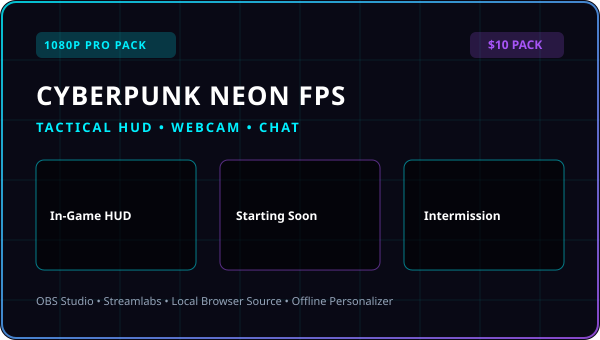 | **Cyberpunk FPS**<br>*Professional multi-scene 1080p stream overlay pack.* | [HUD](packages/cyberpunk-fps/ingame-hud.html) • [Start](packages/cyberpunk-fps/starting-soon.html) • [BRB](packages/cyberpunk-fps/intermission.html) | **$10** [Buy Pack](https://buy.stripe.com/test_cyberpunk_fps) |
| 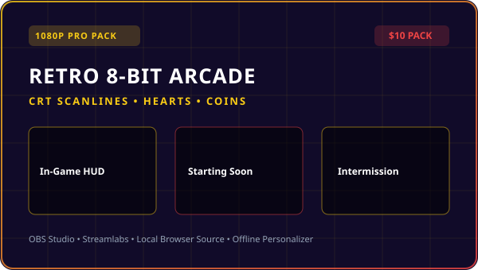 | **Retro 80s Arcade**<br>*Professional multi-scene 1080p stream overlay pack.* | [HUD](packages/retro-arcade/ingame-hud.html) • [Start](packages/retro-arcade/starting-soon.html) • [BRB](packages/retro-arcade/intermission.html) | **$10** [Buy Pack](https://buy.stripe.com/test_retro_arcade) |
| 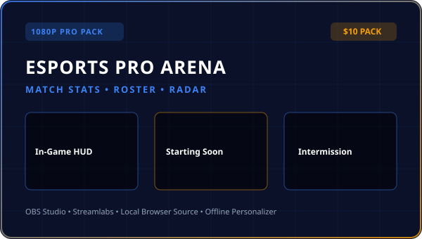 | **Esports Pro Arena**<br>*Professional multi-scene 1080p stream overlay pack.* | [HUD](packages/esports-pro/ingame-hud.html) • [Start](packages/esports-pro/starting-soon.html) • [BRB](packages/esports-pro/intermission.html) | **$10** [Buy Pack](https://buy.stripe.com/test_esports_pro) |
| 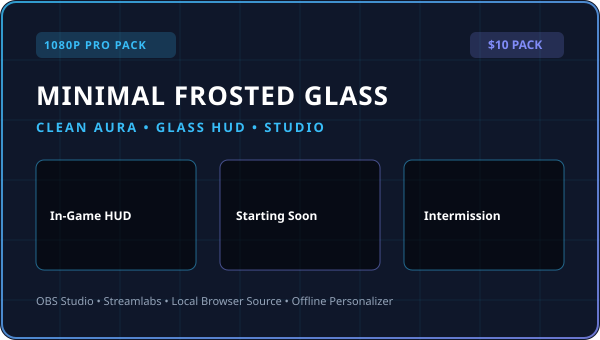 | **Frosted Minimal Glass**<br>*Professional multi-scene 1080p stream overlay pack.* | [HUD](packages/minimal-glass/ingame-hud.html) • [Start](packages/minimal-glass/starting-soon.html) • [BRB](packages/minimal-glass/intermission.html) | **$10** [Buy Pack](https://buy.stripe.com/test_minimal_glass) |
| 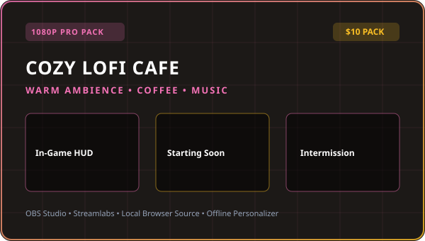 | **Cozy Lofi Study & Chill**<br>*Professional multi-scene 1080p stream overlay pack.* | [HUD](packages/cozy-lofi/ingame-hud.html) • [Start](packages/cozy-lofi/starting-soon.html) • [BRB](packages/cozy-lofi/intermission.html) | **$10** [Buy Pack](https://buy.stripe.com/test_cozy_lofi) |
| 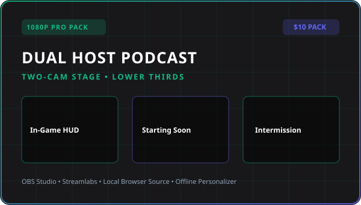 | **Broadcast Podcast & Talk**<br>*Professional multi-scene 1080p stream overlay pack.* | [HUD](packages/podcast-talk/ingame-hud.html) • [Start](packages/podcast-talk/starting-soon.html) • [BRB](packages/podcast-talk/intermission.html) | **$10** [Buy Pack](https://buy.stripe.com/test_podcast_talk) |
| 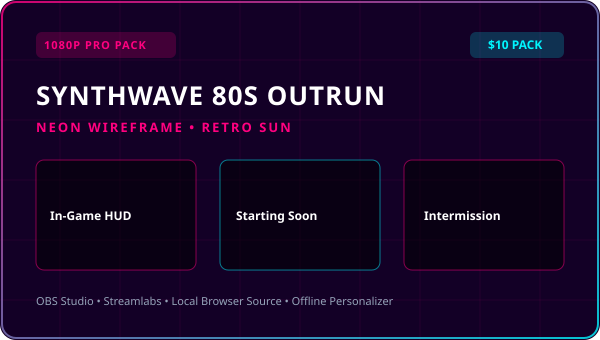 | **Outrun Synthwave Neon**<br>*Professional multi-scene 1080p stream overlay pack.* | [HUD](packages/synthwave-retro/ingame-hud.html) • [Start](packages/synthwave-retro/starting-soon.html) • [BRB](packages/synthwave-retro/intermission.html) | **$10** [Buy Pack](https://buy.stripe.com/test_synthwave_retro) |
| 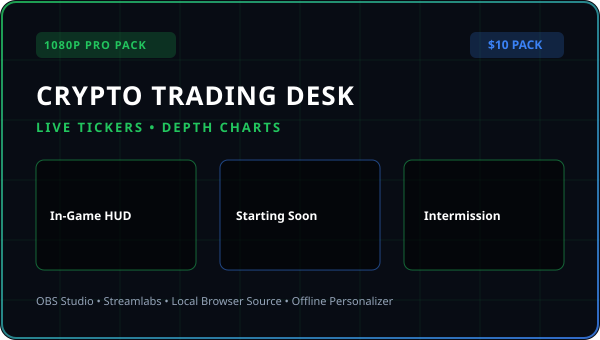 | **Crypto & Market Trading**<br>*Professional multi-scene 1080p stream overlay pack.* | [HUD](packages/crypto-finance/ingame-hud.html) • [Start](packages/crypto-finance/starting-soon.html) • [BRB](packages/crypto-finance/intermission.html) | **$10** [Buy Pack](https://buy.stripe.com/test_crypto_finance) |
|  | **IRL Outdoor & Fitness**<br>*Professional multi-scene 1080p stream overlay pack.* | [HUD](packages/irl-fitness/ingame-hud.html) • [Start](packages/irl-fitness/starting-soon.html) • [BRB](packages/irl-fitness/intermission.html) | **$10** [Buy Pack](https://buy.stripe.com/test_irl_fitness) |
| 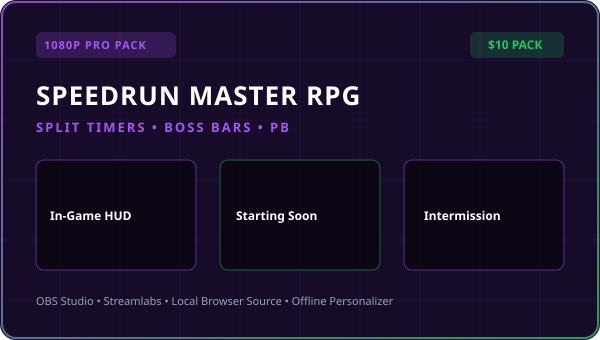 | **Speedrun & RPG Quest**<br>*Professional multi-scene 1080p stream overlay pack.* | [HUD](packages/speedrun-quest/ingame-hud.html) • [Start](packages/speedrun-quest/starting-soon.html) • [BRB](packages/speedrun-quest/intermission.html) | **$10** [Buy Pack](https://buy.stripe.com/test_speedrun_quest) |
|  | **Dark Fantasy / Elden Souls**<br>*Gothic stone architecture, glowing ember particles, golden runes, and mist vignette for dark action RPGs.* | [HUD](packages/dark-fantasy-souls/ingame-hud.html) • [Start](packages/dark-fantasy-souls/starting-soon.html) • [BRB](packages/dark-fantasy-souls/intermission.html) | **$10** [Buy Pack](https://buy.stripe.com/test_dark_fantasy_souls) |
| 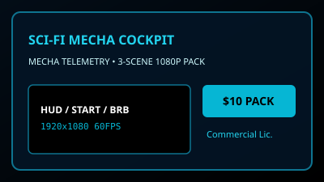 | **Sci-Fi Mecha Cockpit**<br>*Tactical spacecraft HUD, orbital trajectory rings, shield integrity meters, and cyan telemetry readouts.* | [HUD](packages/scifi-mecha/ingame-hud.html) • [Start](packages/scifi-mecha/starting-soon.html) • [BRB](packages/scifi-mecha/intermission.html) | **$10** [Buy Pack](https://buy.stripe.com/test_scifi_mecha) |
| 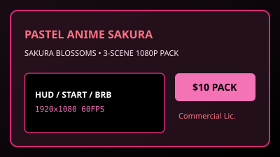 | **Pastel Anime Sakura**<br>*Floating cherry blossom petals, gentle pastel gradients, cute Japanese manga frames, and serene aesthetics.* | [HUD](packages/anime-sakura/ingame-hud.html) • [Start](packages/anime-sakura/starting-soon.html) • [BRB](packages/anime-sakura/intermission.html) | **$10** [Buy Pack](https://buy.stripe.com/test_anime_sakura) |
|  | **Steampunk Victorian Workshop**<br>*Polished brass gears, pressure steam gauges, antique copper framing, and sepia lantern warmth.* | [HUD](packages/steampunk-victorian/ingame-hud.html) • [Start](packages/steampunk-victorian/starting-soon.html) • [BRB](packages/steampunk-victorian/intermission.html) | **$10** [Buy Pack](https://buy.stripe.com/test_steampunk_victorian) |
| 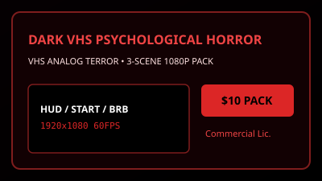 | **Dark VHS Psychological Horror**<br>*Static glitch distortion, flickering flashlight illumination, blood red vignettes, and analog tape timestamps.* | [HUD](packages/horror-haunted/ingame-hud.html) • [Start](packages/horror-haunted/starting-soon.html) • [BRB](packages/horror-haunted/intermission.html) | **$10** [Buy Pack](https://buy.stripe.com/test_horror_haunted) |
| 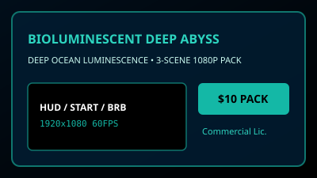 | **Bioluminescent Deep Abyss**<br>*Submerged rising bubbles, deep sea navy depths, glowing turquoise jellyfish tendrils, and tranquil currents.* | [HUD](packages/underwater-abyss/ingame-hud.html) • [Start](packages/underwater-abyss/starting-soon.html) • [BRB](packages/underwater-abyss/intermission.html) | **$10** [Buy Pack](https://buy.stripe.com/test_underwater_abyss) |
| 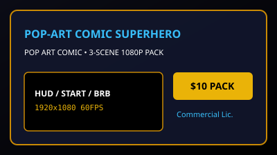 | **Pop-Art Comic Superhero**<br>*Halftone dot patterns, ink splash borders, comic blast speech bubbles, and high-energy heroic colors.* | [HUD](packages/comic-superhero/ingame-hud.html) • [Start](packages/comic-superhero/starting-soon.html) • [BRB](packages/comic-superhero/intermission.html) | **$10** [Buy Pack](https://buy.stripe.com/test_comic_superhero) |
|  | **Midnight Drift Street Racing**<br>*High-RPM speedometer dials, carbon fiber accents, neon tire smoke underglow, and asphalt reflections.* | [HUD](packages/neon-racing/ingame-hud.html) • [Start](packages/neon-racing/starting-soon.html) • [BRB](packages/neon-racing/intermission.html) | **$10** [Buy Pack](https://buy.stripe.com/test_neon_racing) |
| 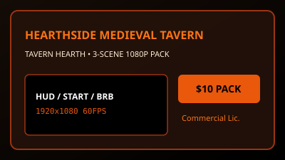 | **Hearthside Medieval Tavern**<br>*Flickering fireplace glow, sturdy oak plank textures, warm amber ale lighting, and rustic iron hardware.* | [HUD](packages/medieval-tavern/ingame-hud.html) • [Start](packages/medieval-tavern/starting-soon.html) • [BRB](packages/medieval-tavern/intermission.html) | **$10** [Buy Pack](https://buy.stripe.com/test_medieval_tavern) |
|  | **Artisan Culinary & Kitchen**<br>*Polished white marble countertops, fresh herbal green accents, wooden recipe card framing, and clean lighting.* | [HUD](packages/cooking-chef/ingame-hud.html) • [Start](packages/cooking-chef/starting-soon.html) • [BRB](packages/cooking-chef/intermission.html) | **$10** [Buy Pack](https://buy.stripe.com/test_cooking_chef) |
|  | **Neon DJ Booth & Beat Lab**<br>*Real-time reactive visualizer bars, vinyl record turntable spin, equalizer audio faders, and purple club glow.* | [HUD](packages/music-dj-studio/ingame-hud.html) • [Start](packages/music-dj-studio/starting-soon.html) • [BRB](packages/music-dj-studio/intermission.html) | **$10** [Buy Pack](https://buy.stripe.com/test_music_dj_studio) |
| 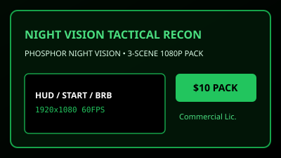 | **Night Vision Tactical Recon**<br>*Monochrome phosphor green night vision, thermal military coordinates, satellite gridlines, and crosshairs.* | [HUD](packages/tactical-military/ingame-hud.html) • [Start](packages/tactical-military/starting-soon.html) • [BRB](packages/tactical-military/intermission.html) | **$10** [Buy Pack](https://buy.stripe.com/test_tactical_military) |
|  | **90s Vaporwave & Glitch Art**<br>*Classical marble statues, magenta-cyan sunset gradients, retro desktop dialog boxes, and palm silhouettes.* | [HUD](packages/vaporwave-glitch/ingame-hud.html) • [Start](packages/vaporwave-glitch/starting-soon.html) • [BRB](packages/vaporwave-glitch/intermission.html) | **$10** [Buy Pack](https://buy.stripe.com/test_vaporwave_glitch) |
| 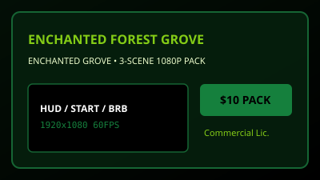 | **Enchanted Forest Grove**<br>*Twinkling golden fireflies, deep emerald canopies, sunbeam god rays, and organic botanical vine borders.* | [HUD](packages/nature-forest/ingame-hud.html) • [Start](packages/nature-forest/starting-soon.html) • [BRB](packages/nature-forest/intermission.html) | **$10** [Buy Pack](https://buy.stripe.com/test_nature_forest) |
|  | **Urban Graffiti & Streetwear**<br>*Gritty brick wall backdrop, neon spray paint drippings, stencil typography, and skate deck flair.* | [HUD](packages/graffiti-urban/ingame-hud.html) • [Start](packages/graffiti-urban/starting-soon.html) • [BRB](packages/graffiti-urban/intermission.html) | **$10** [Buy Pack](https://buy.stripe.com/test_graffiti_urban) |
|  | **Celestial Nebula & Starfield**<br>*Deep space star clusters, swirling violet interstellar clouds, orbital constellation lines, and aurora shimmers.* | [HUD](packages/cosmic-astronomy/ingame-hud.html) • [Start](packages/cosmic-astronomy/starting-soon.html) • [BRB](packages/cosmic-astronomy/intermission.html) | **$10** [Buy Pack](https://buy.stripe.com/test_cosmic_astronomy) |
|  | **Artisan Watercolor & Craft**<br>*Textured cold-press watercolor paper, masking tape pinned borders, delicate paint pigment bleeds, and pencil sketches.* | [HUD](packages/art-craft-maker/ingame-hud.html) • [Start](packages/art-craft-maker/starting-soon.html) • [BRB](packages/art-craft-maker/intermission.html) | **$10** [Buy Pack](https://buy.stripe.com/test_art_craft_maker) |
| 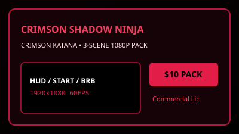 | **Crimson Shadow Ninja**<br>*Matte carbon obsidian, high-contrast blood crimson blade slashes, smoke particles, and Japanese kanji glyphs.* | [HUD](packages/stealth-cyber-ninja/ingame-hud.html) • [Start](packages/stealth-cyber-ninja/starting-soon.html) • [BRB](packages/stealth-cyber-ninja/intermission.html) | **$10** [Buy Pack](https://buy.stripe.com/test_stealth_cyber_ninja) |
|  | **Carnival & Retro Pinball**<br>*Flashing chrome ball bumpers, carnival bulbs, retro score multiplier reels, and marquee chase lights.* | [HUD](packages/arcade-pinball/ingame-hud.html) • [Start](packages/arcade-pinball/starting-soon.html) • [BRB](packages/arcade-pinball/intermission.html) | **$10** [Buy Pack](https://buy.stripe.com/test_arcade_pinball) |
| 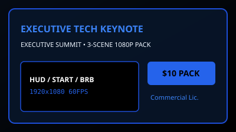 | **Executive Tech Keynote**<br>*Midnight navy slate glass, clean corporate lower thirds, stock ticker indices, and keynote stage elegance.* | [HUD](packages/corporate-tech-summit/ingame-hud.html) • [Start](packages/corporate-tech-summit/starting-soon.html) • [BRB](packages/corporate-tech-summit/intermission.html) | **$10** [Buy Pack](https://buy.stripe.com/test_corporate_tech_summit) |


## 📦 30 Themed Overlay Categories (90 Scenes Total)

| Preview | Category & Description | Live Scenes | Checkout ($10) |
|---|---|---|---|
|  | **Cyberpunk FPS**<br>*Professional multi-scene 1080p stream overlay pack.* | [HUD](packages/cyberpunk-fps/ingame-hud.html) • [Start](packages/cyberpunk-fps/starting-soon.html) • [BRB](packages/cyberpunk-fps/intermission.html) | **$10** [Buy Pack](https://buy.stripe.com/test_cyberpunk_fps) |
|  | **Retro 80s Arcade**<br>*Professional multi-scene 1080p stream overlay pack.* | [HUD](packages/retro-arcade/ingame-hud.html) • [Start](packages/retro-arcade/starting-soon.html) • [BRB](packages/retro-arcade/intermission.html) | **$10** [Buy Pack](https://buy.stripe.com/test_retro_arcade) |
|  | **Esports Pro Arena**<br>*Professional multi-scene 1080p stream overlay pack.* | [HUD](packages/esports-pro/ingame-hud.html) • [Start](packages/esports-pro/starting-soon.html) • [BRB](packages/esports-pro/intermission.html) | **$10** [Buy Pack](https://buy.stripe.com/test_esports_pro) |
|  | **Frosted Minimal Glass**<br>*Professional multi-scene 1080p stream overlay pack.* | [HUD](packages/minimal-glass/ingame-hud.html) • [Start](packages/minimal-glass/starting-soon.html) • [BRB](packages/minimal-glass/intermission.html) | **$10** [Buy Pack](https://buy.stripe.com/test_minimal_glass) |
|  | **Cozy Lofi Study & Chill**<br>*Professional multi-scene 1080p stream overlay pack.* | [HUD](packages/cozy-lofi/ingame-hud.html) • [Start](packages/cozy-lofi/starting-soon.html) • [BRB](packages/cozy-lofi/intermission.html) | **$10** [Buy Pack](https://buy.stripe.com/test_cozy_lofi) |
|  | **Broadcast Podcast & Talk**<br>*Professional multi-scene 1080p stream overlay pack.* | [HUD](packages/podcast-talk/ingame-hud.html) • [Start](packages/podcast-talk/starting-soon.html) • [BRB](packages/podcast-talk/intermission.html) | **$10** [Buy Pack](https://buy.stripe.com/test_podcast_talk) |
|  | **Outrun Synthwave Neon**<br>*Professional multi-scene 1080p stream overlay pack.* | [HUD](packages/synthwave-retro/ingame-hud.html) • [Start](packages/synthwave-retro/starting-soon.html) • [BRB](packages/synthwave-retro/intermission.html) | **$10** [Buy Pack](https://buy.stripe.com/test_synthwave_retro) |
|  | **Crypto & Market Trading**<br>*Professional multi-scene 1080p stream overlay pack.* | [HUD](packages/crypto-finance/ingame-hud.html) • [Start](packages/crypto-finance/starting-soon.html) • [BRB](packages/crypto-finance/intermission.html) | **$10** [Buy Pack](https://buy.stripe.com/test_crypto_finance) |
|  | **IRL Outdoor & Fitness**<br>*Professional multi-scene 1080p stream overlay pack.* | [HUD](packages/irl-fitness/ingame-hud.html) • [Start](packages/irl-fitness/starting-soon.html) • [BRB](packages/irl-fitness/intermission.html) | **$10** [Buy Pack](https://buy.stripe.com/test_irl_fitness) |
|  | **Speedrun & RPG Quest**<br>*Professional multi-scene 1080p stream overlay pack.* | [HUD](packages/speedrun-quest/ingame-hud.html) • [Start](packages/speedrun-quest/starting-soon.html) • [BRB](packages/speedrun-quest/intermission.html) | **$10** [Buy Pack](https://buy.stripe.com/test_speedrun_quest) |
|  | **Dark Fantasy / Elden Souls**<br>*Gothic stone architecture, glowing ember particles, golden runes, and mist vignette for dark action RPGs.* | [HUD](packages/dark-fantasy-souls/ingame-hud.html) • [Start](packages/dark-fantasy-souls/starting-soon.html) • [BRB](packages/dark-fantasy-souls/intermission.html) | **$10** [Buy Pack](https://buy.stripe.com/test_dark_fantasy_souls) |
|  | **Sci-Fi Mecha Cockpit**<br>*Tactical spacecraft HUD, orbital trajectory rings, shield integrity meters, and cyan telemetry readouts.* | [HUD](packages/scifi-mecha/ingame-hud.html) • [Start](packages/scifi-mecha/starting-soon.html) • [BRB](packages/scifi-mecha/intermission.html) | **$10** [Buy Pack](https://buy.stripe.com/test_scifi_mecha) |
|  | **Pastel Anime Sakura**<br>*Floating cherry blossom petals, gentle pastel gradients, cute Japanese manga frames, and serene aesthetics.* | [HUD](packages/anime-sakura/ingame-hud.html) • [Start](packages/anime-sakura/starting-soon.html) • [BRB](packages/anime-sakura/intermission.html) | **$10** [Buy Pack](https://buy.stripe.com/test_anime_sakura) |
|  | **Steampunk Victorian Workshop**<br>*Polished brass gears, pressure steam gauges, antique copper framing, and sepia lantern warmth.* | [HUD](packages/steampunk-victorian/ingame-hud.html) • [Start](packages/steampunk-victorian/starting-soon.html) • [BRB](packages/steampunk-victorian/intermission.html) | **$10** [Buy Pack](https://buy.stripe.com/test_steampunk_victorian) |
|  | **Dark VHS Psychological Horror**<br>*Static glitch distortion, flickering flashlight illumination, blood red vignettes, and analog tape timestamps.* | [HUD](packages/horror-haunted/ingame-hud.html) • [Start](packages/horror-haunted/starting-soon.html) • [BRB](packages/horror-haunted/intermission.html) | **$10** [Buy Pack](https://buy.stripe.com/test_horror_haunted) |
|  | **Bioluminescent Deep Abyss**<br>*Submerged rising bubbles, deep sea navy depths, glowing turquoise jellyfish tendrils, and tranquil currents.* | [HUD](packages/underwater-abyss/ingame-hud.html) • [Start](packages/underwater-abyss/starting-soon.html) • [BRB](packages/underwater-abyss/intermission.html) | **$10** [Buy Pack](https://buy.stripe.com/test_underwater_abyss) |
|  | **Pop-Art Comic Superhero**<br>*Halftone dot patterns, ink splash borders, comic blast speech bubbles, and high-energy heroic colors.* | [HUD](packages/comic-superhero/ingame-hud.html) • [Start](packages/comic-superhero/starting-soon.html) • [BRB](packages/comic-superhero/intermission.html) | **$10** [Buy Pack](https://buy.stripe.com/test_comic_superhero) |
|  | **Midnight Drift Street Racing**<br>*High-RPM speedometer dials, carbon fiber accents, neon tire smoke underglow, and asphalt reflections.* | [HUD](packages/neon-racing/ingame-hud.html) • [Start](packages/neon-racing/starting-soon.html) • [BRB](packages/neon-racing/intermission.html) | **$10** [Buy Pack](https://buy.stripe.com/test_neon_racing) |
|  | **Hearthside Medieval Tavern**<br>*Flickering fireplace glow, sturdy oak plank textures, warm amber ale lighting, and rustic iron hardware.* | [HUD](packages/medieval-tavern/ingame-hud.html) • [Start](packages/medieval-tavern/starting-soon.html) • [BRB](packages/medieval-tavern/intermission.html) | **$10** [Buy Pack](https://buy.stripe.com/test_medieval_tavern) |
|  | **Artisan Culinary & Kitchen**<br>*Polished white marble countertops, fresh herbal green accents, wooden recipe card framing, and clean lighting.* | [HUD](packages/cooking-chef/ingame-hud.html) • [Start](packages/cooking-chef/starting-soon.html) • [BRB](packages/cooking-chef/intermission.html) | **$10** [Buy Pack](https://buy.stripe.com/test_cooking_chef) |
|  | **Neon DJ Booth & Beat Lab**<br>*Real-time reactive visualizer bars, vinyl record turntable spin, equalizer audio faders, and purple club glow.* | [HUD](packages/music-dj-studio/ingame-hud.html) • [Start](packages/music-dj-studio/starting-soon.html) • [BRB](packages/music-dj-studio/intermission.html) | **$10** [Buy Pack](https://buy.stripe.com/test_music_dj_studio) |
|  | **Night Vision Tactical Recon**<br>*Monochrome phosphor green night vision, thermal military coordinates, satellite gridlines, and crosshairs.* | [HUD](packages/tactical-military/ingame-hud.html) • [Start](packages/tactical-military/starting-soon.html) • [BRB](packages/tactical-military/intermission.html) | **$10** [Buy Pack](https://buy.stripe.com/test_tactical_military) |
|  | **90s Vaporwave & Glitch Art**<br>*Classical marble statues, magenta-cyan sunset gradients, retro desktop dialog boxes, and palm silhouettes.* | [HUD](packages/vaporwave-glitch/ingame-hud.html) • [Start](packages/vaporwave-glitch/starting-soon.html) • [BRB](packages/vaporwave-glitch/intermission.html) | **$10** [Buy Pack](https://buy.stripe.com/test_vaporwave_glitch) |
|  | **Enchanted Forest Grove**<br>*Twinkling golden fireflies, deep emerald canopies, sunbeam god rays, and organic botanical vine borders.* | [HUD](packages/nature-forest/ingame-hud.html) • [Start](packages/nature-forest/starting-soon.html) • [BRB](packages/nature-forest/intermission.html) | **$10** [Buy Pack](https://buy.stripe.com/test_nature_forest) |
|  | **Urban Graffiti & Streetwear**<br>*Gritty brick wall backdrop, neon spray paint drippings, stencil typography, and skate deck flair.* | [HUD](packages/graffiti-urban/ingame-hud.html) • [Start](packages/graffiti-urban/starting-soon.html) • [BRB](packages/graffiti-urban/intermission.html) | **$10** [Buy Pack](https://buy.stripe.com/test_graffiti_urban) |
|  | **Celestial Nebula & Starfield**<br>*Deep space star clusters, swirling violet interstellar clouds, orbital constellation lines, and aurora shimmers.* | [HUD](packages/cosmic-astronomy/ingame-hud.html) • [Start](packages/cosmic-astronomy/starting-soon.html) • [BRB](packages/cosmic-astronomy/intermission.html) | **$10** [Buy Pack](https://buy.stripe.com/test_cosmic_astronomy) |
|  | **Artisan Watercolor & Craft**<br>*Textured cold-press watercolor paper, masking tape pinned borders, delicate paint pigment bleeds, and pencil sketches.* | [HUD](packages/art-craft-maker/ingame-hud.html) • [Start](packages/art-craft-maker/starting-soon.html) • [BRB](packages/art-craft-maker/intermission.html) | **$10** [Buy Pack](https://buy.stripe.com/test_art_craft_maker) |
|  | **Crimson Shadow Ninja**<br>*Matte carbon obsidian, high-contrast blood crimson blade slashes, smoke particles, and Japanese kanji glyphs.* | [HUD](packages/stealth-cyber-ninja/ingame-hud.html) • [Start](packages/stealth-cyber-ninja/starting-soon.html) • [BRB](packages/stealth-cyber-ninja/intermission.html) | **$10** [Buy Pack](https://buy.stripe.com/test_stealth_cyber_ninja) |
|  | **Carnival & Retro Pinball**<br>*Flashing chrome ball bumpers, carnival bulbs, retro score multiplier reels, and marquee chase lights.* | [HUD](packages/arcade-pinball/ingame-hud.html) • [Start](packages/arcade-pinball/starting-soon.html) • [BRB](packages/arcade-pinball/intermission.html) | **$10** [Buy Pack](https://buy.stripe.com/test_arcade_pinball) |
|  | **Executive Tech Keynote**<br>*Midnight navy slate glass, clean corporate lower thirds, stock ticker indices, and keynote stage elegance.* | [HUD](packages/corporate-tech-summit/ingame-hud.html) • [Start](packages/corporate-tech-summit/starting-soon.html) • [BRB](packages/corporate-tech-summit/intermission.html) | **$10** [Buy Pack](https://buy.stripe.com/test_corporate_tech_summit) |

